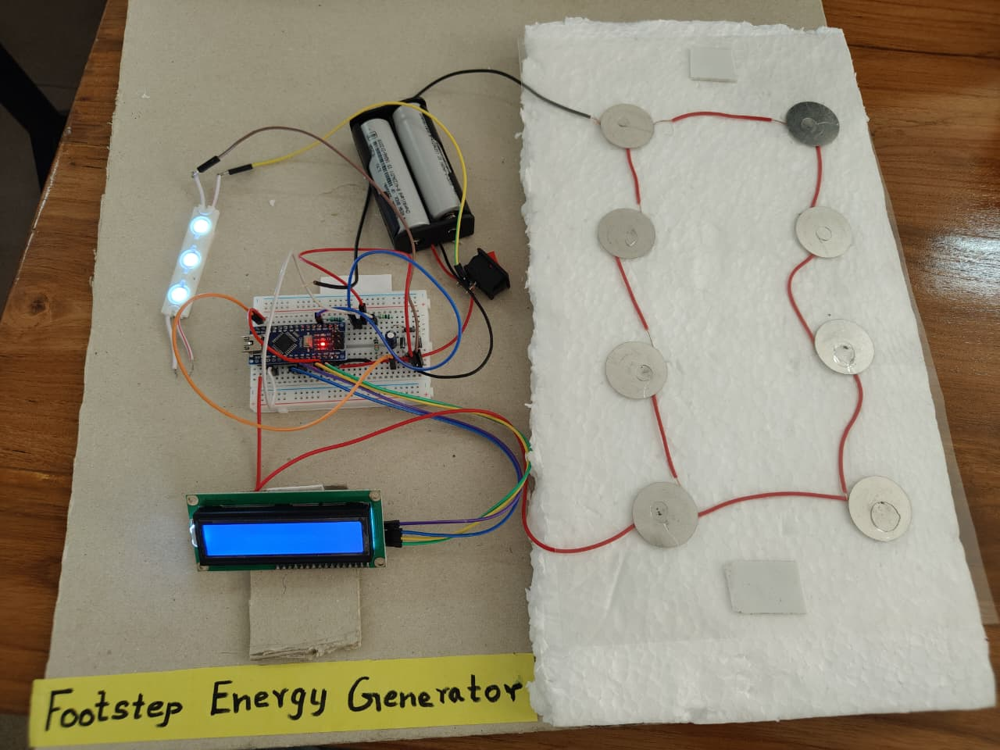

# Footstep Energy Generator

A prototype that converts the mechanical energy of footsteps into electrical energy using piezoelectric sensors, with an Arduino Nano monitoring the output. Built for **Project Expo 2026** at KPR Institute of Engineering and Technology, Coimbatore.

## Overview

Every footstep applies pressure that is normally wasted. In this prototype, eight piezoelectric discs mounted on a foam base generate a small voltage when stepped on. An Arduino Nano reads this signal, counts footsteps and shows the live voltage on a 16x2 LCD.

## Components

- 8 × piezoelectric sensor discs
- Arduino Nano
- 16x2 LCD display with I2C module
- 2 × 18650 rechargeable batteries with holder
- On/off switch
- LED module
- Breadboard and jumper wires
- Foam sheet and cardboard base

## How It Works

1. A person steps on the foam platform, pressing the piezoelectric discs.
2. The discs convert the mechanical pressure into a small electrical voltage.
3. The Arduino Nano reads the voltage through analog pin A0.
4. A footstep is counted whenever the voltage crosses a set threshold.
5. The LCD shows the live voltage and total step count.

## Code

The Arduino sketch is in [`footstep_generator.ino`](footstep_generator.ino).

**Library required:** `LiquidCrystal_I2C` (install from the Arduino IDE Library Manager).

**Pin connections:**

| Connection | Arduino Nano Pin |
|---|---|
| Piezo sensor output | A0 |
| LCD SDA | A4 |
| LCD SCL | A5 |
| LCD VCC / GND | 5V / GND |

## Skills Demonstrated

- Basic electronics and circuit prototyping
- Arduino programming (C/C++)
- Sensor interfacing and signal reading
- Problem identification and teamwork

## Future Improvements

- Improve energy-harvesting efficiency
- Add circuit protection for high-voltage spikes from hard steps
- Improve the overall mechanical design of the platform

## Author

**Sriram S**
B.E.CSE(AI/ML),KPR Institute of Engineering and Technology,Coimbatore
[LinkedIn](https://linkedin.com/in/sriram-s-3a051b411) | [GitHub](https://github.com/sriram202135-hue)
